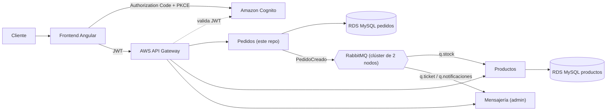

# TecnoMarket · Microservicio de pedidos

Microservicio de pedidos de **TecnoMarket**, una tienda en línea de productos tecnológicos construida con arquitectura de microservicios en AWS. Registra los pedidos en su propia base de datos y publica el evento `PedidoCreado` en RabbitMQ para que el resto del sistema continúe el trabajo de forma asíncrona.

Proyecto académico · Desarrollo Cloud Native I (Duoc UC).

## Repositorios del proyecto

| Componente | Repositorio |
| --- | --- |
| **Pedidos** (este repositorio) | [Tecnomarket-backend](https://github.com/ClaudioCastiDev/Tecnomarket-backend) |
| Productos y stock | [Tecnomarket-productos](https://github.com/ClaudioCastiDev/Tecnomarket-productos) |
| Mensajería y administración de RabbitMQ | [Tecnomarket-mensajeria](https://github.com/ClaudioCastiDev/Tecnomarket-mensajeria) |
| Frontend (Angular) | [Tecnomarket-frontend](https://github.com/ClaudioCastiDev/Tecnomarket-frontend) |

> El proyecto nació como *Pedidos360*, nombre que se conserva en algunos recursos de AWS (por ejemplo, la API `pedidos360-api`).

## Arquitectura



Decisiones principales:

- **Base de datos por servicio.** Pedidos y productos tienen su propia base en Amazon RDS (MySQL); ningún servicio accede a la base de otro.
- **Comunicación asíncrona.** Pedidos no llama directamente a productos: publica un evento y responde al cliente de inmediato. Si productos está lento o detenido, la compra no falla y el mensaje espera en la cola.
- **Defensa en profundidad.** El JWT se valida dos veces: en API Gateway y de nuevo en cada microservicio (firma, emisor, vigencia, `token_use` y `client_id`).
- **Configuración externa.** Las credenciales de base de datos y de RabbitMQ se leen de variables de entorno, fuera del repositorio.

## Qué hace este servicio

1. Recibe `POST /api/pedidos` con el JWT del usuario.
2. Guarda el pedido en su base de datos (RDS MySQL).
3. Publica el evento tres veces, con el mismo `messageId`, hacia stock, ticket y notificación.
4. Responde al cliente con **201**, sin esperar el procesamiento posterior.

Si RabbitMQ falla después de guardar el pedido, el pedido **no se revierte**: se registra el error en los logs y el cliente recibe su respuesta.

## Seguridad

El servicio es un *resource server* OAuth 2.0 (Spring Security) que valida los tokens emitidos por Amazon Cognito. Como los access tokens de Cognito no incluyen el claim `aud`, se implementó un validador propio que verifica `client_id`, además del emisor, la firma (claves JWKS del user pool) y la vigencia.

| Operación | Requisito de acceso |
| --- | --- |
| `GET /api/pedidos`, `GET /api/pedidos/{id}` | Scope `rs-api-pedidos/pedidos-read` |
| `POST /api/pedidos` | Scope `rs-api-pedidos/pedidos-write` |
| `DELETE /api/pedidos/{id}` | Grupo `admin` (rol `ADMIN`) |

- Token ausente, alterado o vencido → **401**.
- Token válido sin el permiso necesario → **403**.

## Mensajería

Este servicio es el **productor**. Publica en dos exchanges:

| Exchange | Tipo | Routing key | Cola | Consumidor |
| --- | --- | --- | --- | --- |
| `tecnomarket.pedidos.direct` | direct | `pedido.stock` | `q.stock` | Productos: descuenta el stock |
| `tecnomarket.pedidos.direct` | direct | `pedido.ticket` | `q.ticket` | Mensajería: genera el ticket |
| `tecnomarket.eventos.topic` | topic | `pedido.#`, `producto.#` | `q.notificaciones` | Mensajería: notificación |

Cada cola principal declara su *dead letter exchange* (`tecnomarket.dlx`), por lo que un mensaje rechazado termina en su cola de errores (`*.dlq`).

La publicación usa confirmaciones del broker (*publisher confirms*), mensajes obligatorios (`mandatory`) y retornos, de modo que un mensaje no enrutable queda registrado en los logs.

Los nombres de exchanges, colas y routing keys se definen solo en el bloque `tecnomarket.rabbit` del `application.yml` y se leen mediante clases de propiedades tipadas. Los exchanges, colas y bindings se declaran como beans en `RabbitTopologyConfig`.

### Consistencia del inventario (lado consumidor)

Esto ocurre en el servicio de productos, pero es parte del diseño del flujo:

- **Idempotencia.** RabbitMQ garantiza entrega "al menos una vez"; una tabla de pedidos procesados evita descontar dos veces el mismo pedido.
- **Descuento atómico.** El stock se descuenta con una sola sentencia `UPDATE ... WHERE stock >= cantidad`, lo que impide que compras simultáneas dejen stock negativo.
- **ACK manual y reintentos acotados.** Los errores de negocio van directo a la DLQ; los errores técnicos se reintentan hasta 3 veces con espera creciente (1, 2 y 3 s).

## Stack

Java 17 · Spring Boot 4.1 · Spring Security (OAuth 2.0 Resource Server) · Spring AMQP · Spring Data JPA · MySQL · Maven

## Ejecución local

Requisitos: Java 17, una base de datos MySQL, un broker RabbitMQ y un user pool de Amazon Cognito para validar los tokens.

Las credenciales de base de datos y de RabbitMQ se leen de variables de entorno (ver `src/main/resources/application.yml`).

```bash
./mvnw spring-boot:run
```

## Pruebas

```bash
./mvnw test
```

18 pruebas con JUnit 5, Mockito y Spring Security Test. Cubren las reglas de seguridad (401 y 403), la publicación de eventos y la lógica del servicio.

Resultado conjunto de los cuatro repositorios: 98 pruebas automatizadas, 0 fallos.

## Despliegue

- Los tres microservicios se ejecutan en una instancia **Amazon EC2** como servicios de `systemd` (reinicio automático).
- Las bases de datos residen en **Amazon RDS (MySQL)**.
- El clúster de RabbitMQ (2 nodos) se levanta con **Docker Compose** en la misma instancia; el puerto AMQP no se expone a internet.
- **AWS API Gateway** (HTTP API, 15 rutas) es el punto de entrada único, con autorizador JWT de Cognito y CORS restringido al origen del frontend.

> El proyecto corre en AWS Academy Learner Lab, entorno que detiene los recursos al finalizar cada sesión, por lo que no hay una URL pública permanente.

## Limitaciones conocidas y mejoras propuestas

| Limitación | Mejora propuesta |
| --- | --- |
| Las colas son clásicas y residen en un solo nodo del clúster. | Migrar a *quorum queues*, replicadas entre nodos. |
| El ticket se genera aunque el descuento de stock falle. | Patrón Saga con evento de compensación. |
| Una petición con datos inválidos responde 403 en lugar de 400. | Permitir la ruta `/error` en la configuración de seguridad. |
| Credenciales en archivos de entorno de la instancia. | AWS Secrets Manager o Parameter Store. |

## Autores

Claudio Castillo · [GitHub](https://github.com/ClaudioCastiDev) · [LinkedIn](https://www.linkedin.com/in/claudiocastillo-)
Santiago Lopez
